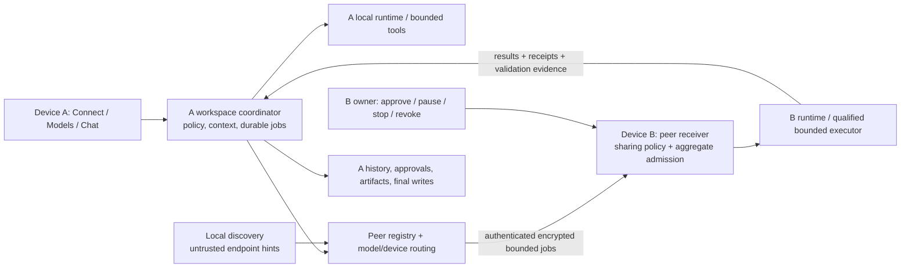
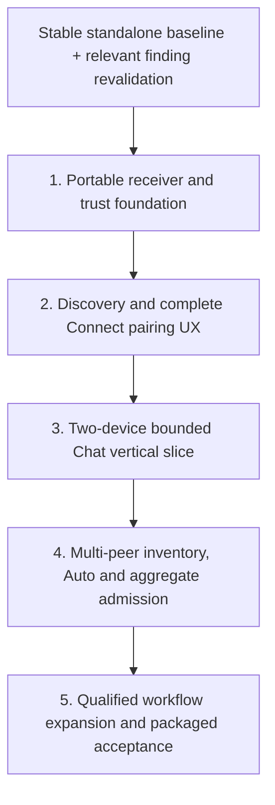

# Distributed Architecture Initial Plan

Date: 2026-11-12. Status: **proposed execution plan; no implementation or device qualification**.

Refinix should let a user open Connect, discover reachable Refinix installations on the same local
network, select a device, obtain approval from its owner, and use the models that owner permits it
to share. Both devices run Refinix; an Internet-free personal hotspot is an intended scenario.
The experience should feel as approachable as Bluetooth pairing. The proposed transport is LAN
networking, not Bluetooth. Device identities survive address changes; a permanent IP configuration
is unnecessary. “My models” and “Connected device models” are two views of eligible execution
choices, with Auto choosing a permitted model/device pair and explaining the choice.

This document refines the existing **post-Beta Phase 3 — Trusted-device mesh**. It does not change
Beta 0.1 scope, activate the retained development mesh, replace the current harness, or authorise
implementation, installations, model downloads, deployments, or release publication. Future builder,
agent, model, subscription and funding choices remain undecided and are not technical dependencies.
Merging this planning PR would accept a proposed direction, not certify a working mesh.

## 1. Intent, corrections and scope

The user's cab-map/Bluetooth analogy describes the desired interaction, not a fixed layout or a
network specification. Start with an accessible device list/cards; evaluate an optional radar view
later. A radar may show reachability and connection state, never invented physical distance or GPS
positions. No map provider, location permission or geolocation service is needed.

| User intent | Engineering interpretation |
| --- | --- |
| Both devices have Refinix installed | A compatible, running installation with explicitly enabled discovery/sharing; installation alone does not grant network visibility or compute access |
| Same hotspot/network, even without Internet | Reachable peers on a user-approved local interface; no public account, discovery directory, cloud inference or relay is required |
| No permanently configured IP | Different devices have distinct usable addresses. Discovery resolves current IP/port; authenticated identity, not an IP address or display name, owns trust |
| Click a device, receiver accepts or denies | A bounded pairing request, guided identity authentication, and explicit confirmation on both sides; denial/expiry leaves no usable relationship |
| My models and connected models | Local inventory plus each trusted receiver's permitted installed inventory; no copying weights or joining model contexts |
| Auto works across devices | Filter trust, data policy, workflow capability, compatibility and capacity first; then rank model/device pairs and obtain receiver admission |
| Create a cluster | A set of individually trusted compute relationships, with each requesting workspace retaining its own coordinator; no elected global leader |

“Same network” is necessary for the first scope but not sufficient: guest networks and some
hotspots isolate clients; multicast discovery and direct peer connections can be blocked separately.
A fallback can bypass missing discovery only when direct connectivity is available. It cannot repair
client isolation. No guarantee is made for every hotspot, OS build or router configuration.

**Included in the proposed outcome:** Windows, macOS and Linux peer roles on selected qualified
profiles; discovery and guided fallback; bilateral pairing and revocation; receiver sharing controls;
private model inventory; bounded remote work; multi-peer routing/admission; recovery and offline
acceptance evidence. Each desktop may request work and separately opt in to receiving it.

**Outside this plan:** public-Internet/cloud mesh, NAT traversal/relays, Bluetooth transport, phone
clients, mandatory Kubernetes/Redis on desktops, pooled RAM/VRAM, model sharding, KV migration,
combined context windows, automatic workspace migration/failover, automatic model downloads,
transitive trust, shared-corpus access, and a replacement agent framework. Preserve managed
Kubernetes/Redis infrastructure for its existing use; it is not the desktop discovery mechanism.

## 2. Authority and observed starting point

Product requirements come from [PROJECT.md](../PROJECT.md), particularly sections 6, 9–12, 20–21
and 23; [tasks.md](../../tasks.md#phase-3--trusted-device-mesh) keeps Phase 3 deferred after Beta.
[Security](../security.md) owns trust, transport, sandbox and data boundaries;
[model-catalog.md](../model-catalog.md) owns provenance and model policy;
[releases.md](../releases.md) owns package/update acceptance. Those authorities are not rewritten by
this proposal. The [5 October direction](../beta-user-direction-2026-10-05.md) remains the baseline:
reuse the existing foundation, keep local Ollama and managed llama.cpp paths, and defer distribution.

Source inspected locally: `e6b9858d880c8200cce6e8a4ca2784190c662f44`. Remote integration baseline
verified on 2026-11-12: `dev` at `bbaaf14f701f0bbec76ec13d346ad725ca7a44db`.
Their diff contains five workflow files only, so the source and product documents cited here agree
between those snapshots. Recheck the integration head before implementation; these are dated
source observations, not proof of secure or packaged runtime behaviour.

| Reuse area | Source evidence | Gap to close |
| --- | --- | --- |
| Product mesh boundary | [server.py](../../backend/coordinator/server.py), `mesh_enabled` | Packaged Beta keeps mesh disabled; a source development switch is not a product rollout |
| Authenticated relationship | [pairing.py](../../backend/coordinator/pairing.py), [worker pairing](../../backend/worker/pairing.py), `Coordinator.pair` and worker `/v1/pairing/confirm` | Current flow uses manually supplied address/certificate/fingerprint/code, not automatic discovery and receiver approval |
| Protected secrets | [credentials.py](../../backend/coordinator/credentials.py) | Reuse Keychain, Windows Credential Manager and Linux Secret Service; qualify peer private-key custody, locked-store and recovery behaviour separately |
| Worker/job protocol | [contracts/v1.py](../../backend/contracts/v1.py), [dispatch.py](../../backend/coordinator/dispatch.py), [worker dispatch](../../backend/worker/dispatch.py) | Preserve identifiers, bounds, receipts, events, cancellation, ownership and fencing; add negotiated peer capabilities without silently changing existing semantics |
| Worker implementation | [worker/app.py](../../backend/worker/app.py), [worker/runtime.py](../../backend/worker/runtime.py), [executor.py](../../backend/worker/executor.py) | Current managed worker requires its durable Redis dispatch backend, serves an Ollama path and uses deployment-layer TLS; it is not a portable desktop receiver |
| Durable coordinator state | [db.py](../../backend/coordinator/db.py), `active_relationship` | Current lookup chooses the newest single worker for a workspace; enumerate independent peer relationships and targets |
| Runtime and capacity | [runtime.py](../../backend/coordinator/runtime.py), [local_engine.py](../../backend/coordinator/local_engine.py), [capacity.py](../../backend/coordinator/capacity.py) | Reuse local adapters and accounting; integrate receiver-wide local/remote admission and durable peer receipts rather than pretending the local ledger is a complete fleet scheduler |
| UI | [app.js](../../frontend/app/app.js), [pairing design](../../frontend/design/pairing.html), [desktop lifecycle](../../desktop/lifecycle.py) | Existing manual pairing UI/static design are references; Connect discovery, receiving approval, two inventory groups and portable receiver lifecycle need implementation |

The retained wire contract 1.1 requires measured, qualified execution profiles, and current remote
routing checks exact matching profiles/model identity. Broad compatible **local** model support does
not silently relax that worker boundary. Keep the existing path valid. If the new desktop peer path
is to support broader compatible models, define a separately negotiated contract/capability and an
explicitly approved remote-admission policy first. Preserve exact runtime/model/settings identity,
locality, provenance, resource, tool and output checks; never fabricate a measured profile.

The existing [review PR #88](https://github.com/prachi-satbhai0741/Refinix/pull/88), especially its
[repair/dependency handoff](https://github.com/prachi-satbhai0741/Refinix/pull/88#issuecomment-6667451245),
is an input for rechecking affected transport, worker isolation, admission, receipts and recovery.
It is review evidence, not repaired behaviour or a branch to merge as a dependency. Revalidate the
relevant findings against the chosen implementation head before exposing any retained worker path.

## 3. Recommended architecture

Keep one canonical coordinator per workspace. Add an app-managed peer execution role on each
installation, using the existing bounded application protocol and local runtime adapters. Isolate the
minimal LAN listener from the loopback UI/coordinator and model-runtime surfaces. A paired peer
must not gain access to general coordinator settings, arbitrary files or a raw runtime API.



This diagram shows A requesting B's compute. B keeps its own workspace and can request work in the
opposite direction only under a separate grant. A trusting B and B trusting C does not make A trust C.
There is no peer-to-peer forwarding of a job to an unapproved third device.

### 3.1 Discovery finds locators, not trusted identities

Recommend DNS-SD over link-local mDNS as the first discovery candidate, with a guided address or
invitation fallback. mDNS works without a conventional DNS server; DNS-SD enumerates service
instances and resolves service endpoints. These mechanisms describe discovery, not authentication.
See [RFC 6762](https://www.rfc-editor.org/rfc/rfc6762) and
[RFC 6763](https://www.rfc-editor.org/rfc/rfc6763).

- Discovery begins when the user opens Connect/enables discovery. Receiving new pairing requests
  requires a visible, bounded “Allow pairing” window; default off on a new installation.
- Existing approved sharing is a separate visible setting, so closing Connect need not revoke an
  existing relationship. Advertisements used for trusted reconnect remain minimal and opt-in.
- Use an application service type such as `_refinix._tcp.local.` as a proposal, not an assigned
  protocol name or port. Finalise naming, collision handling and port policy in the foundation work.
- Advertise only an approved display alias, protocol hint and current service locator/session hint.
  Even the alias can reveal presence: explain visibility and offer a generic alias. No prompt,
  model list, workload, corpus path, credentials or raw hardware inventory in multicast records.
- Treat every record as untrusted: bound packet/record sizes, device counts, lifetimes, parsing,
  connection attempts and refresh rates. Escape names in UI; deduplicate advertisements without
  treating a matching name or self-reported ID as proof of identity.
- Bind discovery and the peer listener to explicitly approved local interfaces. Handle multiple NICs,
  address changes, IPv4/IPv6 scope IDs, duplicate names and stale records. Do not automatically
  bridge Wi-Fi, VPN, container or virtual interfaces or scan arbitrary address ranges.
- Restrict endpoint connections to the approved on-link scope, validate resolved addresses at use,
  bypass proxies and refuse redirects. Do not trust public/loopback/internal service destinations
  supplied in advertisements or untrusted invitations. The user's own local runtime is accessed
  separately through its existing loopback adapter.
- Persist stable authenticated identity and scoped relationships independently of endpoint caches.
  After DHCP change, rediscover an address and verify the previously trusted identity **before**
  sending tokens or task data. An old IP reused by a different device must fail closed.
- Address change may reconnect automatically to the same authenticated peer. Certificate/key change
  or lost key must stop with a visible recovery/re-pair flow. A copied UUID/name/workspace without
  the protected private key cannot inherit trust. Do not use network reachability or a node UUID
  to silently overwrite a trust anchor. Exclude private keys from ordinary exports/workspace copies;
  define explicit key-retention/recovery behaviour for updates and reinstall.
- Detect/quarantine conflicting duplicate identities where observable, but do not promise universal
  clone detection: an attacker holding the same private key can authenticate as that identity.
  Use protected/non-exportable key custody where supported; key compromise requires revocation,
  rekey and explicit re-pairing. This plan does not introduce hardware attestation.

If multicast fails, the peer can display a guided invitation/address. The same identity and approval
checks still apply. If direct unicast is blocked, show “Network prevents device-to-device connections”
with simple guidance; a pairing code is not a network tunnel. No automatic firewall disablement,
public directory, relay or Internet fallback is introduced.

### 3.2 Pairing is authenticated, directional consent

The required user journey is:

1. A opens Connect. B has enabled Allow pairing and appears as an **unpaired** reachable device.
2. A selects B and requests the clearly stated permission “Use B's shared compute.” No job or model
   inventory is transferred yet. B shows a pending request with the claimed requester identity,
   scope and expiry; unverified names are labelled as such.
3. Both users complete guided identity authentication. Recommend adapting the current out-of-band
   pinned-TLS bootstrap into an app-guided invitation/verification flow using established mechanisms;
   no certificate shell commands, blind trust-on-first-use, invented crypto or trusting mDNS pins.
   A plain Accept click does not establish that the advertised device is the intended one.
4. B explicitly accepts or denies. A confirms the verified peer and requested scope. The grant
   remains default-deny until receiver sharing policy is configured and persisted.
5. B chooses shared models/task categories and resource limits. Only successful authentication,
   both confirmations and the persisted sharing policy may activate the scoped credential. Reverse
   compute sharing is an independent, explicit grant. Neither direction grants workspace/corpus access.
6. Both sides show paired, sharing direction, permissions and revocation controls. An interrupted
   confirmation remains pending/expired until reconciled; never display paired from a local click.

Receiving requires the app's explicitly enabled peer role to be running; a closed or sleeping app
is not promised to be discoverable. Pairing requests appear in the app, with an optional local OS
notification that reveals no prompt content. Notification permission denial must not prevent
in-app approval. Provide keyboard operation, labelled controls, screen-reader state updates,
predictable focus and states understandable without colour or animation. Any later background
sharing mode needs explicit opt-in and qualified lifecycle/resource behaviour.

The foundation work must choose and review the exact established bootstrap implementation before
network-facing pairing is enabled. It must bind the authenticated device identity, requesting
workspace, pending request, permission scope and fresh session; enforce one-time use, expiry,
replay resistance and rate limits; and prevent request substitution. A short displayed comparison
code alone is not a specified secure protocol. Do not send bootstrap pairing secrets, relationship
credentials or task data over a network connection before authenticating the intended peer. If a
separate pairing library is necessary, review
its design, provenance and packaging before adoption. A QR representation may be evaluated as an
optional guided transfer, not a camera requirement. This PR does not approve a new handshake.

Reuse OS-protected relationship secrets. Define durable installation-private-key storage, certificate
creation, renewal, rotation and loss recovery on all three OS families; current managed TLS
termination cannot simply be assumed on desktop. Do not add a plaintext secret fallback when the
OS store is unavailable. Ensure keychain/credential-store writes and relationship database updates
recover coherently from crashes; expired or denied sessions leave no usable credential. Authenticate
all post-pairing health/inventory/job operations and retain per-relationship authorisation isolation.
The pre-pairing surface is limited to bounded discovery/pairing requests and exposes no job access.

Pairing permits the receiving computer to process the bounded inputs sent to it. Encryption protects
the connection; it does not hide those inputs from that computer's owner/administrator. Explain this
before the user enables remote execution. Organisation/corpus approval is a separate policy layer.

### 3.3 Model inventory and user choices

Reuse the existing model inventory and UI patterns; create two views, not a second catalogue system.

| View/control | Required behaviour |
| --- | --- |
| My models | Existing local Ollama and Refinix-managed llama.cpp entries; origin chooses the runtime; no duplicate weights or mandatory runtime chooser |
| Connected device models | Group the receiver's permitted installed models by authenticated device; show available, busy, paused, stale, offline and incompatible states |
| Exact selection | Bind device identity + relationship + runtime identity/version + model revision/digest + relevant settings/capabilities; identical display names are distinguishable |
| Auto / This device | Consider local candidates only |
| Auto / Trusted devices allowed | Consider local plus explicitly permitted trusted peers within data/workflow policy |
| Pinned device/model | Run there, queue there or explain why unavailable; never silently switch devices/models |
| No eligible target | Explain trust/capability/data/resource reason and offer an authorised local option; never invent successful execution |

Inventory is fetched only over an authenticated relationship and includes its revision, freshness and
capability evidence. Refresh on reconnect, model install/remove/change and sharing-policy changes;
revalidate at admission. A cached listing can remain visible as unavailable but cannot imply readiness.
Unknown measurements remain unknown; estimates and published evidence remain labelled. Loaded does
not automatically mean compatible or capable. A paired device may share no models.

Weights stay on the execution target. Pairing does not install/copy a remote model, start downloads,
expose Ollama/llama.cpp to the LAN or allow editing/deleting another person's models. Confidential
work excludes cloud/remote-backed runtime entries. A remotely listed model does not by itself make
attachments, Documents, code tools or every workflow supported.

### 3.4 Routing, capacity and bounded execution

Extend the existing routing path rather than replace the harness:

1. Derive task and context requirements from the existing workflow and original request.
2. Apply hard filters: explicit target, relationship/grant, data/corpus locality, negotiated contract,
   model/runtime/capability, provenance and applicable remote-admission policy, receiver health,
   sharing controls, input format/context limits, sandbox/tools and current resource feasibility.
3. Rank eligible model/device pairs with a simple explainable cost estimate: queue + transfer + load
   + execution. Use fresh observations where available and label missing estimates. Prefer local
   when remote benefit is unsupported or transfer would dominate; do not promise GPU speedup.
4. Ask the receiving agent to admit/reserve. It atomically accounts for its local work **and all**
   requesting workspaces, sharing budgets, memory, concurrency and queue limits. A coordinator's
   advertised-capacity snapshot is never a reservation. Stale/busy responses trigger a bounded
   reroute or wait only within Auto's granted policy; prevent repeated routing loops.
5. Persist the selected device/model, input hashes, reason, job/step/attempt IDs, idempotency key,
   receipt/reservation and deadline before execution can become ambiguous. Receiver admission and
   durable enqueue must have crash-consistent semantics; a reservation has a bounded lease and
   idempotent release/reconciliation, not a separate untracked side channel.
6. Transfer only the bounded task package: original request, selected context/inputs with hashes,
   allowed tools, limits, output/validation contract and approval reference. Receive bounded events,
   results and artifacts; validate schemas, identity, sizes, paths, hashes and task association.
7. Keep history, approvals, final artifacts and canonical writes on the requesting coordinator.
   The receiving agent uses assigned temporary storage, cannot broaden authority and cannot apply
   a patch directly to the requesting workspace.

Start with bounded text Chat including selected conversation context, not just the latest raw
prompt. File-bearing Chat remains local/unsupported remotely until its transport is qualified.
Remote Code later needs bounded selected files, a qualified no-network sandbox on the executing
profile, matching patch/validation evidence, fresh applicability checks and approval before Apply.
Documents may stay local; extend remote formats only after transfer, validation, tool and retention
requirements are met. Unsupported tools must never fall back to unrestricted host execution.

### 3.5 Lifecycle, revocation and failure recovery

Keep separate states for discovery, trust, sharing and an individual attempt. For example:

- Discovery: searching, candidate, stale, unreachable, permission denied.
- Relationship: unpaired, pending authentication/approval, paired, denied/expired, revoked,
  identity changed; sharing enabled/paused is a separate setting.
- Attempt: queued/admitted, running, validating, awaiting approval, completed, cancelled,
  failed or interrupted/receipt unknown, preserving the existing contract's states.

Do not rename existing wire states casually. Map UI labels to negotiated protocol states and typed
reasons. Bound discovery and pairing windows, heartbeat freshness, health polls, request bodies,
queue depth, event/output buffers, retries and temporary storage; select measured limits during
implementation rather than treating illustrative values as acceptance evidence.

Pause rejects new admission and explicitly offers the disposition of running work. Stop/Cancel is
available on both requester's job UI and receiver's activity UI. Revocation immediately removes local
permission, invalidates credentials/sessions and fences queued/running work on reachable peers. If
unreachable, show remote stop/reconciliation pending; do not claim execution stopped remotely.
Restart must preserve the fence and stop expired work before accepting further actions.

A lost submit reply means **receipt unknown**, not “nothing ran.” Reconcile using the same attempt
and durable receipt/event identity before retrying; only safely repeatable work gets a new attempt
under policy. Never promise exactly-once network execution. Canonical completion/writes remain
idempotent, late results are checked against fences/current attempt state, and incomplete output is
preserved as such. Disconnection/revocation never deletes either device's own workspace.

Define retention separately for temporary task payloads, outputs and minimal recovery/audit metadata.
Clean payloads after completion/failure/cancel/revoke and after crash recovery; retain only necessary
bounded receipt/fence metadata for reconciliation. No prompt bodies in discovery, notifications or
routine audit logs. Retention does not claim secure erasure of all OS/storage copies.

## 4. Dependencies and adoption gates

No dependency is installed or added to a manifest by this plan. A named candidate is not an approved
shipping dependency. Before adopting any new component, record authoritative source, exact release
and commit, licence/notices, target wheels/builds, transitive dependencies, hashes, vulnerabilities,
network behaviour and material local changes; include it in reproducible platform locks and notices.
Provision approved dependencies during connected setup or from an offline bundle, never silently
while performing normal work.

| Dependency/capability | Recommendation and reason | Gate/trade-off |
| --- | --- | --- |
| Existing Python, HTML/JS, SQLite, shared Pydantic contracts | Reuse current stack and durable state; avoid a second coordinator/framework | Backward-compatible schema migrations, backup/recovery and caller integration; no new web framework merely for preference |
| mDNS/DNS-SD | Evaluate `python-zeroconf` first for the Python app's single discovery implementation | Candidate snapshot: [zeroconf 0.154.0](https://pypi.org/project/zeroconf/0.154.0/), upstream publishing commit `7c44d724dc5334a643072ddbd6d6274085273723`; LGPL-2.1-or-later. Packaging/licence, interface and IPv6 qualification precede selection |
| OS-native DNS-SD alternative | Use if the Python candidate fails package/licence/interface acceptance, not as a second simultaneous stack | More per-OS integration cost; Windows has [DnsServiceBrowse](https://learn.microsoft.com/en-us/windows/win32/api/windns/nf-windns-dnsservicebrowse). Native APIs do not prove packaged interoperability |
| TLS, certificate/key provisioning and authenticated bootstrap | Reuse established TLS/pinning/credential mechanisms and a reviewed app-guided bootstrap | Desktop listener needs its own qualified termination and key lifecycle; do not depend on an operator's OpenSSL commands or deployment proxy being installed |
| OS protected storage | Reuse current Keychain/Credential Manager/Secret Service adapters | Real user-session/locked-store evidence required; safe refusal when unavailable; no mandatory new generic credential library |
| Durable receiver receipts/queue | Prefer app-local SQLite for standalone peers, extending existing durable-state patterns | Preserve worker receipt/idempotency/fence semantics across concurrency/restart; never substitute an in-memory queue. Existing Redis backend stays for managed deployments |
| Ollama and managed llama.cpp | Reuse each receiver's installed compatible runtime/model path | Runtime locality, identity, settings and ownership checks; current worker adapter supports less than the proposed desktop path |
| Platform listener/discovery permissions | Minimal user-approved LAN exposure plus clear denial/recovery UX | macOS app identity/Local Network permission, Windows firewall/profile, Linux firewall/session integration need package/device evidence |
| Qualified sandbox/toolchain | Reuse qualified existing platform paths only for supported remote task categories | Code unavailable on an unqualified receiver; inference sharing must not grant arbitrary host tools |
| Validation devices/network | Two real desktops first, then selected same-OS/cross-OS pairs, hotspot/router and three-device contention | Required human/device availability before those gates; not a reason to block this planning PR |

The [python-zeroconf upstream documentation](https://github.com/python-zeroconf/python-zeroconf)
reports LGPL-2.1-or-later, operation without requiring Bonjour/Avahi daemons, default use of available
interfaces, and IPv6/interface limitations. These justify explicit interface selection and a packaging
spike; they do not establish suitability or licence compliance for a frozen Refinix app. Pinning the
candidate here records research, not a promise to ship that version. Refresh upstream evidence at
execution time and record the selected dependency's exact revision before adoption.

Apple's [Local Network privacy guidance](https://developer.apple.com/documentation/technotes/tn3179-understanding-local-network-privacy)
requires user-facing permission handling and explains responsible app/helper identity. Terminal-run
success is insufficient evidence for an installed app. Its code-signature identity guidance also
creates a qualification question for Refinix's current ad hoc macOS packaging; do not silently make
paid signing a requirement or bypass privacy controls. Test installed builds, permission denial,
restart and app replacement on the chosen OS versions before making a support claim.

No mapping SDK, geolocation service, cloud account, cloud queue, paid builder plan, Kubernetes,
Redis server, public CA, central identity server or LangGraph migration is a prerequisite for
ordinary desktop peers. If a concrete implementation later needs a new dependency, justify it
against the existing code and these offline/trust constraints.

## 5. Execution sequence and dependencies

These are proposed major outcomes with implementation checklists, not authorisation to start work.
Do not turn every file into a separate task or rebuild completed standalone features.



### 1. Portable receiver and trust foundation

Prerequisites: authorise implementation after the standalone baseline is stable; select an immutable
source head; revalidate affected PR #88 findings and repair relevant safety/ownership defects before
exposing their paths. This is not contingent on merging the review PR or choosing a particular agent.

- [ ] Trace existing UI/API, coordinator, runtime, worker, storage, validator and update-shutdown
      callers; preserve current local behaviours and wire 1.1 managed-worker compatibility.
- [ ] Finalise a documented threat/trust design for the desktop listener, protected durable identity,
      app-guided established bootstrap, directional grants, protocol negotiation and key recovery.
      Obtain explicit approval for any remote-admission/security policy change and named protected
      document updates; retain strict existing admission until that gate passes.
- [ ] Qualify/select discovery, TLS provisioning and any bootstrap dependency; add only necessary
      version/hash-pinned packages and notices under later implementation authorisation.
- [ ] Build the app-managed receiver lifecycle with minimum LAN surface, private local receipts,
      atomic admission/enqueue, bounded executor, crash recovery and proper shutdown/update quiescence.
      Reuse existing handlers/contracts where suitable; isolate managed-backend differences only
      where they actually exist. No Redis/K3s requirement for desktop peers.
- [ ] Add durable non-secret peer/relationship/endpoint metadata and private receipt/fence records;
      scope all keys/events/artifacts/cancel operations by relationship/workspace/attempt. Preserve
      existing data and define transactional rollback for partially completed setup/migrations.

Exit evidence: focused offline contract/identity/ownership/queue/recovery checks plus qualified
listener/key-storage behaviour on selected OS profiles. No graphical mesh release is claimed yet.

### 2. Discovery and complete Connect pairing UX

Depends on foundation trust and lifecycle. Discovery can be developed against bounded fakes before
real network trials; it must not become an unauthenticated job surface.

- [ ] Implement user-initiated discovery, explicit receiver pairing availability, accessible device
      list and current endpoint refresh. Keep radar optional and avoid distance claims.
- [ ] Complete both-side authentication/approval, denial, expiry, cancel, duplicate-request handling,
      request limits and safe half-finished-session cleanup. Unverified identity stays labelled.
- [ ] Add directional sharing controls, shared-model/task selection, receiver limits, pause, revoke
      and activity/stop UI. Preserve workspace isolation and do not imply reverse consent.
- [ ] Add guided fallback and actionable permission/firewall/isolation errors; qualify DHCP change,
      identical names, IP reuse and reconnect without silently replacing identity.

Exit evidence: two installed devices discover and pair graphically with no certificate commands;
accept works, deny/expiry/replay fail safely, both workspaces survive revoke. Discovery remains
best-effort with an honest directly reachable fallback.

### 3. Two-device bounded Chat vertical slice

Depends on a paired relationship, the retained strict remote-admission policy or an explicitly
approved negotiated replacement, private inventory and durable receiver dispatch. Begin with one
receiver/one requester before adding fleet ranking.

- [ ] Expose only shared authenticated model inventory, initially using one compatible installed
      model; retain local Ollama and managed llama.cpp as product paths and qualify both adapters.
- [ ] Integrate a bounded selected-context text Chat request, receiver admission, durable submit
      receipt, progress/events, cancellation and validated result commit by the requester.
- [ ] Show execution device/model, concise route reason, remote-data scope and receiver activity.
      Keep unsupported attachments/tools local or visibly unavailable.
- [ ] Exercise disconnect, sleep/wake, restart, lost acknowledgement, late output, cancellation and
      revoke. Reconcile uncertain receipts before any repeat or fallback.

Exit evidence: an Internet-blocked hotspot run from graphical pairing through a real eligible local
model on the peer to requester-owned history; no public inference/discovery/download dependency,
no duplicate canonical result and receiver controls work. Record actual runtime/settings/device,
network evidence and limitations. A text-only slice is not complete Phase 3 acceptance.

### 4. Multi-peer inventory, Auto and aggregate admission

Depends on reliable two-device execution, not on a new global cluster service.

- [ ] Replace newest-single-relationship assumptions in all affected callers with explicit eligible
      candidate sets, without breaking the old managed path or local-only selection.
- [ ] Present My models and Connected device models with stable target identity, inventory revision,
      availability and capability evidence; stale/uninstalled/disabled models cannot be admitted.
- [ ] Extend Auto to model/device candidates using hard filters and labelled costs. Keep explicit
      target pins and existing trust/data permissions on every reroute.
- [ ] Enforce receiver-wide atomic capacity, bounded queues and fair sharing across local jobs and
      multiple requesters; preserve reservations, leases, receipts and fences on restart. Start with
      a simple bounded queue and per-relationship limits, not a speculative scheduling platform.
- [ ] Prove no-eligible-target, busy receiver, racing requests, stale inventory, multiple identical
      model names and one offline peer behave predictably. Prevent one peer from seeing/cancelling
      another's jobs or reserving all capacity indefinitely.

Exit evidence: at least three devices or equivalent real multi-requester topology demonstrates
multiple targets and concurrent requester admission; this supplements, rather than replaces,
real cross-OS two-device evidence. Local jobs remain usable while compute is shared.

### 5. Qualified workflow expansion and packaged acceptance

Depends on safe routing/recovery and each workflow's own input/tool/validation contract.

- [ ] Extend supported remote Chat resources, Documents and Code only where bounded transport,
      output validation, retention and the executing OS's containment are qualified. Document
      intentional local-only workflows honestly; remote Documents need not be forced into scope.
- [ ] For Code, qualify selected-file transport, qualified no-network tool execution, bounded output,
      matching validation evidence, fresh patch applicability and approved canonical Apply.
- [ ] Qualify same-OS Windows/Windows, macOS/macOS and Linux/Linux plus selected cross-OS pairs
      covering all three families; no special Linux coordinator/receiver is allowed as a prerequisite.
- [ ] Qualify installed-package permissions/firewalls, offline operation, sleep/wake, startup/exit,
      app update/replacement, credential/key retention and old/new compatible peer versions.
- [ ] Review affected security/supply-chain findings and actual egress/containment evidence before
      exposing the feature. Follow existing immutable package and release gates; preserve ordinary
      standalone operation, approvals, user data and managed-runtime ownership.

Exit evidence: demonstrate the Phase 3 outcome and peer-specific Phase 4 controls on named package,
OS, hardware, runtime and network profiles. Source tests, device observations and release acceptance
are recorded separately. No claim of support for every network, model or device follows.

## 6. Acceptance and verification plan

All rows below are **future checks**, not results of this planning PR. Run relevant offline tests only
when authorised for implementation; network/model/installer/device operations require their own
applicable permission. Use synthetic/non-sensitive inputs and bounded resources.

| Area | Required positive and negative evidence |
| --- | --- |
| Offline discovery | Two running installations on a hotspot without public Internet; opt-in visibility; stop searching; blocked multicast with reachable-unicast fallback; blocked unicast explained |
| Pairing | Both confirm; deny/ignore/cancel/expiry/replay give no usable grant; simultaneous requests do not substitute identities/scopes; half-completed setup recovers safely |
| Identity/address | DHCP reassignment preserves verified identity; same-name impostor, forged advertisement, reused old IP, changed key/cert and copied UUID/workspace without the private key cannot inherit trust; observable duplicate identities quarantined; full private-key compromise handled by revoke/rekey/re-pair, not a universal detection claim |
| Endpoint safety | Reject out-of-scope/public/loopback service targets, redirects and proxy routing; bound malformed/flooded discovery and pairing; NIC/VPN/IPv6 scope handling on offered profiles |
| Secrets/grants | Locked/missing store fails safely; no secret in DB/logs/notifications; one-way grant does not enable reverse sharing, transitive trust, corpus access or another relationship's operations |
| Inventory/routing | Local and remote identical tags remain distinct; stale/removed model rejected; incompatible contract/runtime/tools/resources visible; Auto reason recorded; pins never silently move |
| Receiver capacity | Local plus two remote requesters race for limited capacity without overcommit; queue/lease bounds, fair admission, busy refusal, disconnect/restart release/reconcile correctly |
| Job integrity | Original request and bounded selected context retained; changed input/hash, wrong attempt, oversized/out-of-order event/artifact, unsafe path and output-contract failures rejected |
| Recovery | Drop before/after durable acceptance and during result commit; reconcile same idempotency identity; no duplicate canonical write, uncontrolled fallback or accepted late fenced result |
| Receiver control | Pause stops new admission; running disposition visible; stop/cancel/revoke work queued/running; unreachable peer shows pending remote reconciliation; fences persist after restart |
| Workspace/data | Both devices' histories/files remain separate; bounded temporary data cleanup after all terminal/recovery paths; no whole workspace/corpus sent by default |
| Workflows | Real remote text Chat; unsupported attachments stay local/refuse; Code only with qualified containment and verified patch/approval path; Documents support stated per workflow |
| Packages/platforms | Selected same-OS/cross-OS pairs; real installed UI permission denial/allow, app replacement, update/shutdown and sleep/wake; model runtimes remain loopback-only |
| Sovereignty | Independent observation/enforcement of the offered offline scenario; separate permitted local discovery/encrypted peer traffic from public egress; unavailable evidence is not “zero egress proved” |

Future focused regression anchors, to extend rather than duplicate:

```text
python3 -m unittest backend.contracts.test_contracts backend.coordinator.test_dispatch backend.coordinator.test_credentials
python3 -m unittest backend.worker.test_worker_app backend.worker.test_executor backend.worker.test_worker_runtime
python3 -m unittest backend.coordinator.test_remote_code desktop.test_lifecycle
node --test frontend/app/test-models-card.cjs frontend/app/test-conversations.cjs
```

These are starting selections, not an exhaustive acceptance suite or a statement that dependencies
are installed. Add focused checks alongside new discovery/pairing/receipt/scheduler code and the
existing UI test conventions; choose the final selection from actual changed callers. Pure/fake
checks do not prove native key protection, hotspot reachability, model correctness, containment,
resource enforcement, installed-package behaviour or release acceptance.

## 7. Value, risks and decisions before execution

The useful outcome is access to a model that fits on another trusted device and better throughput
for independent work. The cab-map analogy helps users find compute; it does not establish a speed
advantage. Sequential generation of one answer does not become faster merely by adding laptops.
Transfer, model load, queueing, weak Wi-Fi, sleep and battery pressure can make a remote target worse.
Measure paired local-versus-remote representative tasks, time to first output, total completion,
queue/transfer/load costs, cancellation responsiveness and receiver impact before advertising gains.
No timing, cost, throughput or implementation-duration estimate is asserted without those inputs.

| Risk/open choice | Recommended path and reason | Trade-off / decision gate |
| --- | --- | --- |
| UI is provisional | Accessible device list first, optional radar after usability evidence | Preserves the requested interaction with less rendering work; exact visual design remains a later user review |
| Secure first pairing is not yet a selected portable implementation | Adapt established out-of-band pinned-TLS trust into a reviewed guided flow, keeping both-side consent | Some identity-verification interaction remains; approve the exact bootstrap/security design before exposure |
| Broad peer models versus strict current remote profiles | Keep wire 1.1 strict; design an explicitly negotiated peer admission policy if broader use is required | Existing measured-only remote path is initially narrower; obtain explicit policy/contract approval rather than silently weaken it |
| Discovery library packaging/licence | Evaluate the cited Python candidate before adding three native implementations | LGPL/frozen-app distribution and interface limitations may favour native integration after evidence |
| Hotspot variability and OS permissions | Qualify named installed profiles; show guided fallback and honest network errors | No universal hotspot guarantee; firewall/privacy settings stay user-controlled |
| Desktop durability/security cost | Reuse SQLite and current protocol, with atomic receipts and receiver-wide admission | More engineering than a demo that directly calls another device's Ollama; necessary for recovery and ownership |
| Sensitive data on peers | Explicit eligible destinations and minimum bounded inputs | Transport encryption does not conceal work from the executing host; local-only policy remains available |
| Prior audit and standalone usability issues | Revalidate affected findings; retain stable standalone baseline before mesh exposure | Plan review can proceed now; implementation readiness is a separate judgment |

The user does **not** need to select a future building model or subscription to review this plan.
Before later execution, settle only genuine prerequisites: implementation authorisation, the secure
bootstrap and any remote-admission policy change, available real test devices/networks, permitted
installer/network/runtime checks, and any explicitly named protected-document updates. Do not
re-ask facts already settled in the authoritative product documents. Routine helper placement,
internal naming and focused test design remain implementation choices for the owning agent.

## 8. Review record and evidence boundary

Two explicitly requested read-only subagents examined architecture/source reuse and trust/recovery
constraints, then each reviewed the full draft. Their input identified the single-worker assumption,
managed Redis receiver dependency, deployment-layer TLS, exact remote-profile gate, directional
grants and receipt uncertainty as plan requirements. Draft review corrected a source method name,
made receiver policy default-deny before credential activation, specified identity-before-secret
release and removed a promise to detect a complete private-key clone. These are static plan reviews,
not implementation/security validation. Documentation-integrity results accompany the PR.

This PR changes only this plan and compact normal ledger entries. No application source, core
product authority, dependency manifest, feature flag or release configuration is changed. No test
suite, installer, migration, live model/runtime, remote worker/device or network/service change is
run for the plan. Future evidence must continue to distinguish:

`planned -> implemented/source-present -> tested -> device-observed -> release-accepted`.
